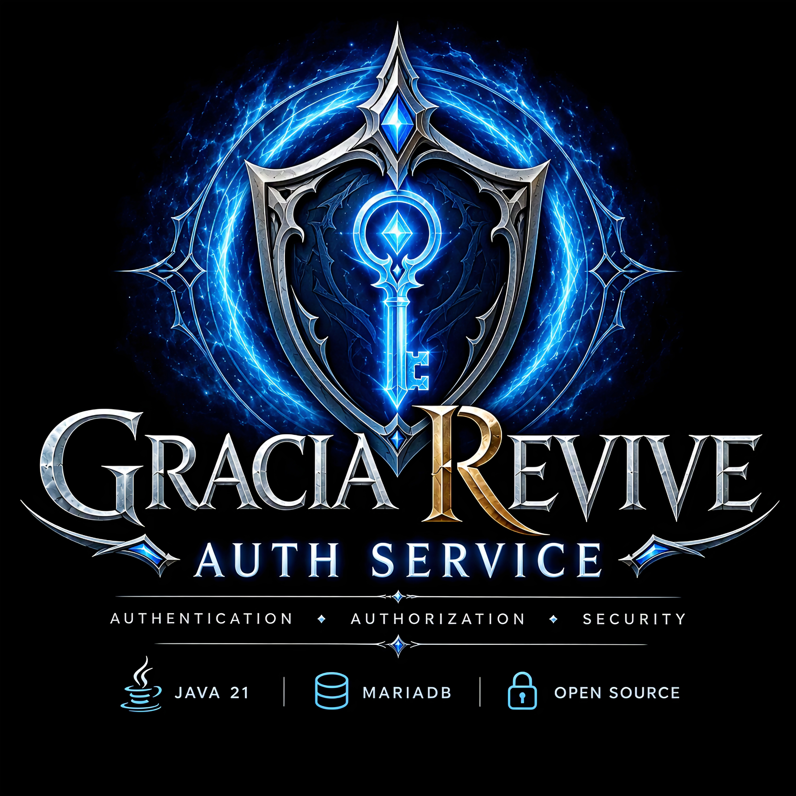

  

  <h1>Auth Service</h1>

  

    Serviciul independent pentru autentificarea utilizatorilor și inițializarea sesiunilor de joc.
  

---

## Responsabilități

- Validarea conturilor și a credențialelor.
- Gestionarea listei serverelor de joc disponibile.
- Generarea cheilor unice de sesiune.
- Securizarea pachetelor de autentificare utilizate în comunicarea cu clienții.

## Arhitectură

- Rulează într-un proces separat de `game-engine`.
- Comunică cu serverele de joc printr-un canal intern securizat.
- Nu gestionează logica de joc sau starea lumii.

