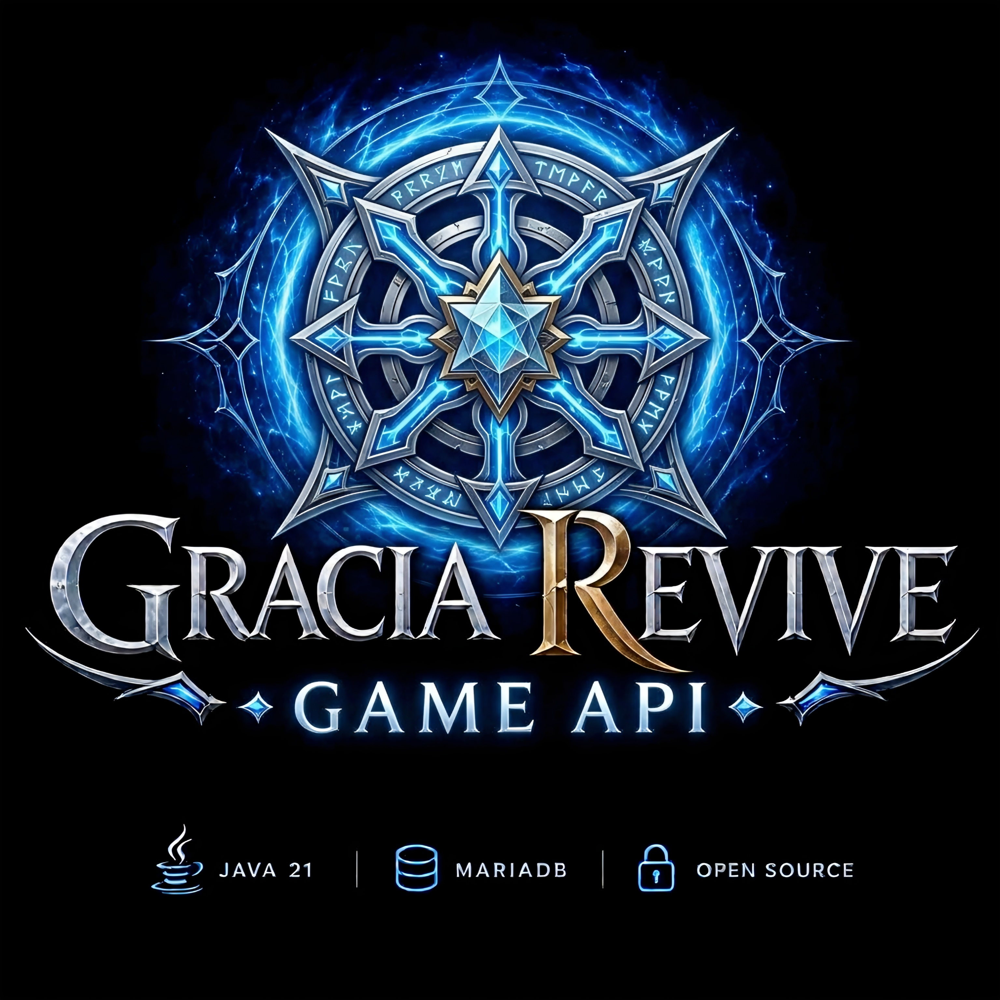

  

  <h1>Stratul de Contracte</h1>

  

    Reprezintă granița arhitecturală dintre nucleul serverului și logica dinamică a jocului.
  

---

## Responsabilități

* Definește interfețele pentru entitățile lumii: `Player`, `Npc` și `Item`.
* Definește sistemul de evenimente și ascultătorii de evenimente (*Event Listeners*).
* Definește contractele pentru AI și mecanismele de interacțiune cu quest-urile.

## Beneficii arhitecturale

* Permite refactorizarea motorului (`game-engine`) fără a afecta scripturile din `game-gameplay`.
* Separă implementarea tehnică de regulile de gameplay.
