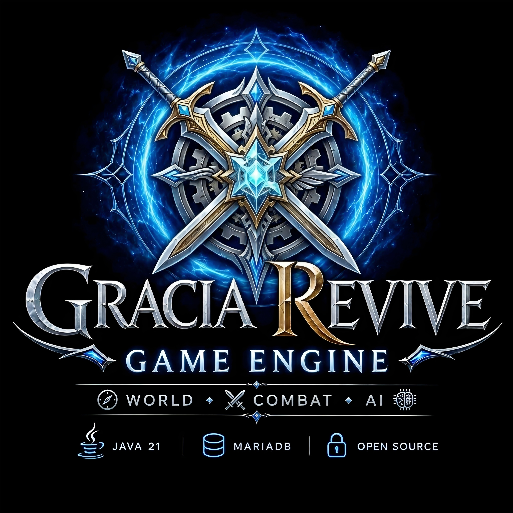

  

  <h1>Game Engine (Nucleu tehnic)</h1>

  

    Motorul principal al jocului, organizat pe straturi: 
    <code>rețea → servicii → persistență → model</code>
  

---

## Responsabilități

- **Rețea:** conexiuni TCP și serializarea/deserializarea pachetelor binare conform protocolului Gracia Final, folosind facilitățile Java 21.
- **Lume și luptă:** hărți, regiuni, vizibilitate (`KnownList`), formule de luptă, abilități și efecte.
- **Persistență:** pool-uri de conexiuni și operații CRUD către baza de date.

## Arhitectură

- Rulează ca proces principal al lumii de joc și comunică cu `auth-service`.
- Folosește contractele definite în `game-api` pentru a încărca dinamic implementările din `game-gameplay`.

